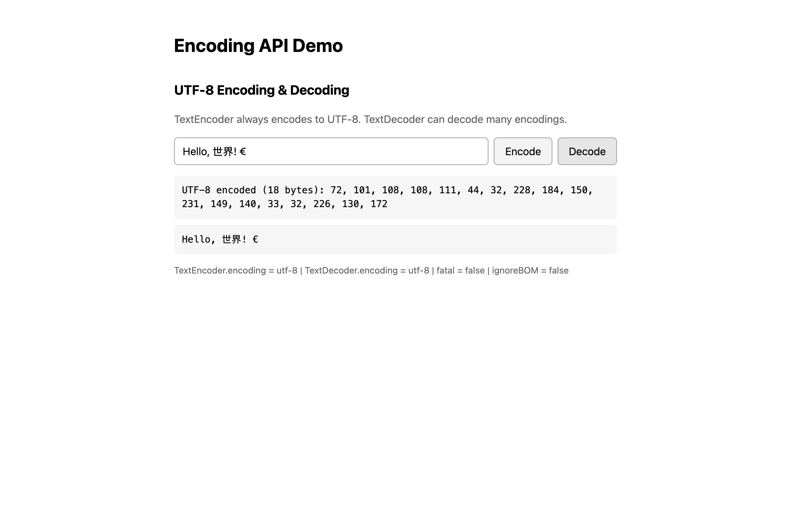

# WebSharper Encoding API Binding

[](https://www.nuget.org/packages/WebSharper.Encoding)

This repository provides an F# [WebSharper](https://websharper.com/) binding for the browser [Encoding API](https://developer.mozilla.org/en-US/docs/Web/API/Encoding_API). It lets WebSharper applications encode JavaScript strings to UTF-8 bytes and decode bytes back to strings.

The Encoding API is **Baseline / Widely available** across modern browsers (see [MDN browser compatibility](https://developer.mozilla.org/en-US/docs/Web/API/Encoding_API#browser_compatibility)).

## Repository structure

| Project | Description |
| --- | --- |
| `WebSharper.Encoding` | The binding (`netstandard2.0`): `TextEncoder`, `TextDecoder`, `TextEncoderStream`, `TextDecoderStream`. |
| `WebSharper.Encoding.Sample` | A WebSharper SPA sample (`net10.0`) demonstrating encode/decode with WebSharper.UI. |
| `docs/` | Sample screenshot used by this README. |

## Live demos

**Try it live:** [Open the sample in your browser](https://dotnet-websharper.github.io/EncodingAPI/)



The sample doubles as the binding's [test case](#running-the-sample): it encodes a string to UTF-8 bytes and decodes them back, showing the byte values and round-trip result.

- **GitHub Pages sample:** <https://dotnet-websharper.github.io/EncodingAPI/>
- **Source repository:** <https://github.com/dotnet-websharper/EncodingAPI>
- **WebSharper bindings:** <https://websharper.com/bindings>

## Installation

```bash
dotnet add package WebSharper.Encoding
```

The binding targets `netstandard2.0` and works with WebSharper 10.1.

## Usage

The sample's [`Client.fs`](WebSharper.Encoding.Sample/Client.fs) uses `TextEncoder` and `TextDecoder` with WebSharper.UI `Var`s and template holes:

```fsharp
namespace WebSharper.Encoding.Sample

open WebSharper
open WebSharper.JavaScript
open WebSharper.UI
open WebSharper.UI.Client
open WebSharper.UI.Templating
open WebSharper.Encoding

[<JavaScript>]
module Client =
    type IndexTemplate = Template<"wwwroot/index.html", ClientLoad.FromDocument>

    let private formatBytes (bytes: Uint8Array) =
        Seq.init bytes.Length (fun i -> string (bytes.Get(i)))
        |> String.concat ", "

    let utf8Input = Var.Create ""

    // Keep the raw encoded bytes so decoding does not have to parse a display string.
    let encodedBytes : Var<Uint8Array option> = Var.Create None

    let utf8Encoded : View<string> =
        encodedBytes.View.Map(fun (bytes: Uint8Array option) ->
            match bytes with
            | None -> "Waiting for input..."
            | Some b -> sprintf "UTF-8 encoded (%d bytes): %s" b.Length (formatBytes b))

    let utf8Decoded = Var.Create "Waiting for decode..."

    let decoderInfo =
        let encoder = new TextEncoder()
        let decoder = new TextDecoder()
        sprintf "TextEncoder.encoding = %s | TextDecoder.encoding = %s | fatal = %b | ignoreBOM = %b"
            encoder.Encoding decoder.Encoding decoder.Fatal decoder.IgnoreBOM

    let encodeUTF8 () =
        let encoder = new TextEncoder()
        let bytes = encoder.Encode(utf8Input.Value)
        encodedBytes.Value <- Some bytes
        utf8Decoded.Value <- "Waiting for decode..."

    let decodeUTF8 () =
        match encodedBytes.Value with
        | None -> utf8Decoded.Value <- "Nothing to decode yet."
        | Some bytes ->
            let decoder = new TextDecoder()
            utf8Decoded.Value <- decoder.Decode(bytes)

    [<SPAEntryPoint>]
    let Main () =
        IndexTemplate.Main()
            .Utf8Input(utf8Input)
            .Utf8Encoded(utf8Encoded)
            .Utf8Decoded(utf8Decoded.V)
            .DecoderInfo(decoderInfo)
            .EncodeUTF8(fun _ -> encodeUTF8())
            .DecodeUTF8(fun _ -> decodeUTF8())
            .Doc()
        |> Doc.RunById "main"
```

The matching template holes in `wwwroot/index.html` are:

```html
<div id="main" ws-children-template="Main">
    <input type="text" placeholder="Enter text" ws-var="Utf8Input" />
    <button ws-onclick="EncodeUTF8">Encode</button>
    <button ws-onclick="DecodeUTF8">Decode</button>
    <p>${Utf8Encoded}</p>
    <p>${Utf8Decoded}</p>
    <p>${DecoderInfo}</p>
</div>
```

### Binding surface

- `TextEncoder` — constructor, `encoding`, `encode`, `encodeInto`.
- `TextDecoder` — constructor with optional `label` and `TextDecoderOptions` (`fatal`, `ignoreBOM`), `encoding`, `fatal`, `ignoreBOM`, `decode` with optional `DecodeOptions` (`stream`).
- `TextEncoderStream`, `TextDecoderStream` — stream-based encoders/decoders.

`EncodeIntoResult` exposes the required `read` and `written` counters returned by `encodeInto`.

## Running the sample

```bash
dotnet build WebSharper.Encoding.Sample/WebSharper.Encoding.Sample.fsproj -c Release
dotnet run --project WebSharper.Encoding.Sample/WebSharper.Encoding.Sample.fsproj
```

Open the URL printed by ASP.NET Core (the sample's launch profile uses `https://localhost:53714`). Enter text, click **Encode** to see the UTF-8 byte list, then click **Decode** to recover the original string. The page also shows the encoder/decoder metadata (`encoding`, `fatal`, `ignoreBOM`).

## Building from source

The repository requires the .NET 10 SDK. The binding targets `netstandard2.0`; the sample targets `net10.0`.

```bash
git clone https://github.com/dotnet-websharper/EncodingAPI.git
cd EncodingAPI
dotnet build WebSharper.Encoding.sln -c Release
```

The WebSharper SPA compilation writes the generated JavaScript, CSS and head files to `WebSharper.Encoding.Sample/wwwroot/Content`.

## Deployment

The GitHub Actions workflow in [`.github/workflows/ghpages.yml`](.github/workflows/ghpages.yml) builds the sample in Release and publishes `WebSharper.Encoding.Sample/wwwroot` to the `gh-pages` branch, which GitHub Pages serves at <https://dotnet-websharper.github.io/EncodingAPI/>.

## License

Apache 2.0. See the [Apache License 2.0](https://www.apache.org/licenses/LICENSE-2.0).
